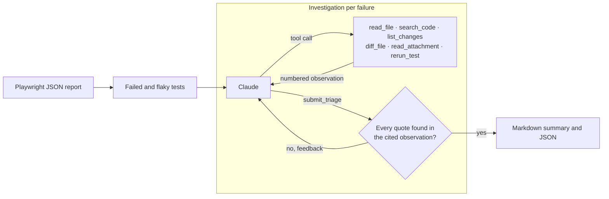

# AITA

[](https://github.com/RetoSchneider/AITA/actions/workflows/quality.yml)

AITA (AI Test Agent) is an agent that finds out why Playwright tests failed. For every failed or flaky test in a report, it reads the test, the page state at the moment of failure and the changes since the last green run. It then decides whether the failure is a **product defect**, an **outdated test**, a **flaky test** or an **environment issue**, and drafts a bug report for real defects.

A classification cites the observations it rests on, and each quote is checked against the text the agent received. An evaluation suite covers 13 failures with a known cause, injected into a real application. The latest evaluation classified all 39 investigations correctly, at an estimated average of $0.06 and 18 seconds per investigation. These are repeated classifications of fixed cases; they do not estimate accuracy on unseen failures.

## How it works



The agent loop is written directly against the Claude Messages API ([triage-agent.ts](src/agent/triage-agent.ts)). Design decisions:

- **Inspection by default.** The agent reads files, searches tracked code, inspects baseline diffs and opens attachments. It has no code-editing tool. Opt-in reruns execute the project's Playwright tests and can change files, databases or other state ([tools.ts](src/agent/tools.ts), [runner.ts](src/playwright/runner.ts)).
- **Checked quotations.** Every tool result is recorded as a numbered observation. Quotes are matched after whitespace normalization and removal of displayed line numbers. Unmatched quotes receive up to two corrections, then remain visibly unverified. Missing evidence or an incomplete bug report instead produces an inconclusive result when the repair budget is exhausted. This checks quotation provenance; it does not prove the diagnosis or the relevance of the quote ([verdict.ts](src/agent/verdict.ts), [observations.ts](src/agent/observations.ts)).
- **Repository content is data.** The system instructions distinguish repository content from instructions for the agent. This reduces prompt-injection risk but is not a security boundary ([instructions.ts](src/agent/instructions.ts)).
- **Bounded investigation.** Tool and turn limits, clipped observations and prompt caching constrain work. They do not impose a hard spending cap. Each result reports tool calls, tokens, estimated cost and duration; cost is unknown when rates for the serving model are unavailable.
- **Honest uncertainty.** `inconclusive` is a valid verdict. The evaluation reports how often the agent commits to a cause and how often it is right when it does.
- **Strict schemas.** Tool inputs and the verdict are Zod schemas, sent to the API as strict JSON schemas and validated again when the model's answer arrives ([schema.ts](src/agent/schema.ts)).
- **Path boundaries.** File reads resolve symlinks and reject paths outside the repository or artifact directory. Git runs without a shell, and diffs disable external diff and text-conversion programs. These checks are not an operating-system sandbox ([paths.ts](src/workspace/paths.ts), [repository.ts](src/workspace/repository.ts)).

The CLI composes the model gateway, repository, artifact store and optional test runner. Each investigation owns its conversation, observations and budget, so concurrent investigations do not share model state. Live reruns are serialized within a command and write to temporary artifact directories. If a batch fails, it stops starting new investigations and waits for active work and cleanup before reporting the error. The implementation uses the SDK directly; an agent framework or service layer would add little to this command-line scope.

## Output

The Markdown summary is meant for a pull request comment or the GitHub job summary. It starts with an overview table of all failures and their causes. Each failure then gets the verdict and confidence, a short explanation, the quoted evidence, a bug report with steps to reproduce for product defects, and the recommended next step. A footer lists the model, tool calls, tokens, cost and time. `--json` writes the same result with the agent's investigation steps for further processing.

[This example](docs/example-triage.md) shows the real output for a declined payment that can no longer be retried. The agent connects the alert in the page snapshot to the commit that stopped resetting the checkout key, and to the server code that rejects the reused key.

## Evaluation

The evaluation measures the agent on failures whose cause is known. Each case breaks [SeatWise](https://github.com/RetoSchneider/SeatWise), a ticketing application with an extensive Playwright suite, at a pinned revision in exactly one way: in its code, in its tests or in its test environment.

| Case                                                                                  | Expected cause    | Fault                                                                                             |
| ------------------------------------------------------------------------------------- | ----------------- | ------------------------------------------------------------------------------------------------- |
| [Reused idempotency key](eval/cases/idempotency-key-ignores-payment-change)           | Product defect    | Checkout stops comparing the request hash, so a reused key replays a declined payment             |
| [Cancelled event published again](eval/cases/cancelled-event-can-be-republished)      | Product defect    | The guard against status changes after a cancellation is removed                                  |
| [Promotion limit exceeded](eval/cases/promotion-limit-exceeded-under-concurrency)     | Product defect    | Concurrent checkouts both pass the redemption limit                                               |
| [Suspended organizer keeps access](eval/cases/suspended-organizer-keeps-access)       | Product defect    | The organizer lookup ignores the profile status                                                   |
| [Declined payment cannot be retried](eval/cases/declined-payment-cannot-be-retried)   | Product defect    | The cart reuses its idempotency key after a declined payment                                      |
| [Payment button renamed](eval/cases/payment-button-renamed)                           | Outdated test     | The button label changes on purpose, the UI test still uses the old one                           |
| [Reservation rate limit raised](eval/cases/reservation-rate-limit-raised)             | Outdated test     | The limit rises from 12 to 30 per minute, the test still expects a `429` after 25                 |
| [Validation error code renamed](eval/cases/validation-error-code-renamed)             | Outdated test     | `VALIDATION_ERROR` becomes `INVALID_REQUEST` in code and docs, the test still expects the old one |
| [Random seats collide](eval/cases/random-seats-collide)                               | Flaky test        | The test picks two random seats out of two, so both reservations often ask for the same seat      |
| [Promotion checked after a fixed wait](eval/cases/promotion-checked-after-fixed-wait) | Flaky test        | The test waits a fixed 30 ms and checks once instead of waiting for the promotion                 |
| [Test database unavailable](eval/cases/database-unavailable)                          | Environment issue | PostgreSQL is stopped before the run                                                              |
| [Server port in use](eval/cases/server-port-in-use)                                   | Environment issue | Another process holds the port the application should start on                                    |
| [Browsers not installed](eval/cases/browsers-not-installed)                           | Environment issue | The browser directory is empty, as on a CI image that skipped the installation                    |

Some cases are deliberately hard to tell apart. The declined-payment defect and the renamed button break the same UI test. Most product defects come with plausible commit messages that make the change look intended. The colliding random seats produce an error message that reads like a race condition in the application.

Each case holds the fault as a git patch with its commit message, the Playwright report and attachments recorded against SeatWise's production build and PostgreSQL database, and, for test failures, recorded rerun outcomes. Evaluation creates one temporary checkout per case at the pinned revision, commits the fault on top, and reuses that checkout across repetitions. Each repetition starts a fresh model conversation. The expected category and fault description stay outside that conversation ([fixtures.ts](src/evaluation/fixtures.ts), [evaluate.ts](src/evaluation/evaluate.ts)).

### Results

The latest evaluation ran after the code review fixes on October 26, 2026, using Claude Opus 5.5 at high effort with three investigations per case ([full scorecard](eval/results/2026-10-26-claude-opus-5-5-high-11c6160e-5b0b-42ea-b348-a1936d13580e.md), [full results](eval/results/2026-10-26-claude-opus-5-5-high-11c6160e-5b0b-42ea-b348-a1936d13580e.json)):

| Metric                     | Result                           |
| -------------------------- | -------------------------------- |
| Correct category           | 39 of 39 runs                    |
| Answered, not inconclusive | 39 of 39 runs                    |
| Same cause in every run    | 13 of 13 cases                   |
| Evidence quotes verified   | 190 of 190                       |
| Tool calls per triage      | 5.1 on average                   |
| Time per triage            | 18 s on average                  |
| Estimated cost             | $2.33 in total, $0.06 per triage |

The scorecard also breaks the result down by cause, with a confusion matrix across all causes, and lists the verdicts of every case. The first run found one real problem: the model wrote search patterns in Perl syntax, which the search tool rejected at the time. The tool now accepts Perl-compatible expressions, and the run above uses that version.

The suite is a development benchmark from one application, not a held-out test set. Repetitions measure consistency over the same code and recorded evidence; they do not rerun the application. Scoring compares categories and checks quotation matches. It does not independently grade explanations, bug-report severity or recommended fixes. Broader claims would need unseen repositories, more failure types and human assessment of the reports.

```bash
pnpm evaluate --repeat 3
```

Scorecards and results, including tool-action records and verdicts, are written to `eval/results` with unique filenames so later runs preserve earlier results. `pnpm record <case-id>` records a case again; it needs Docker and a local SeatWise checkout next to this repository.

## Usage

You need Git with Perl-compatible regular-expression support, Node.js 22.14 or newer, pnpm 10.18.3 and an [Anthropic API key](https://console.anthropic.com/).

```bash
pnpm install --frozen-lockfile
export ANTHROPIC_API_KEY=your-key
pnpm triage --report ../my-app/test-results/results.json --repository ../my-app --baseline origin/main
```

| Option                  | Meaning                                                                   |
| ----------------------- | ------------------------------------------------------------------------- |
| `--report <file>`       | Playwright JSON report (required)                                         |
| `--repository <dir>`    | Repository under test (default: current directory)                        |
| `--artifacts <dir>`     | Directory that attachment paths are relative to (default: the repository) |
| `--baseline <revision>` | Revision where the tests last passed, used for commits and diffs          |
| `--output <file>`       | Write the Markdown summary to a file instead of standard output           |
| `--json <file>`         | Also write the full result as JSON                                        |
| `--rerun`               | Let the agent rerun failing tests                                         |
| `--max-failures <n>`    | Investigate at most n failures (default: 10)                              |
| `--model <id>`          | Claude model (default: `claude-opus-5-5`)                                 |
| `--effort <level>`      | `low`, `medium`, `high`, `xhigh` or `max` (default: `high`)               |
| `--max-tool-calls <n>`  | Tool calls per failure (default: 16)                                      |
| `--concurrency <n>`     | Failures investigated in parallel (default: 2)                            |

The project under test needs Playwright's JSON reporter, for example `["json", { outputFile: "test-results/results.json" }]` in `playwright.config.ts`. For diffs against the baseline, the checkout needs the full history. Report excerpts, requested source files and attachments are sent to the configured Anthropic endpoint. Use `--rerun` only with a trusted checkout and a suitable test environment: it selects a file and source line, so Playwright may also execute tests generated at that same line and project dependencies. Only results matching the requested test's file, line, title and project contribute to the reported counts.

### In GitHub Actions

```yaml
- uses: actions/checkout@v7
  with:
    fetch-depth: 0
- uses: actions/checkout@v7
  if: failure() && github.event_name == 'pull_request'
  with:
    repository: RetoSchneider/AITA
    path: .aita
- name: Triage failed tests
  if: failure() && github.event_name == 'pull_request'
  env:
    ANTHROPIC_API_KEY: ${{ secrets.ANTHROPIC_API_KEY }}
    GH_TOKEN: ${{ github.token }}
    BASELINE: origin/${{ github.base_ref }}
    PR_NUMBER: ${{ github.event.pull_request.number }}
  run: |
    pnpm --dir .aita install --frozen-lockfile
    pnpm --dir .aita build
    node .aita/dist/main.js triage \
      --report test-results/results.json \
      --baseline "$BASELINE" \
      --output triage.md
    gh pr comment "$PR_NUMBER" --body-file triage.md
```

Add these steps around the existing application install, build and Playwright test steps. When `GITHUB_STEP_SUMMARY` is set, the summary is also added to the job summary. Commenting needs `pull-requests: write` permission. The API key must be available to the job; GitHub does not normally expose repository secrets to pull requests from forks.

## Project structure

| Path                                             | Content                                                        |
| ------------------------------------------------ | -------------------------------------------------------------- |
| [src/agent](src/agent)                           | Agent loop, tools, instructions, verdict check, usage and cost |
| [src/playwright](src/playwright)                 | Reading Playwright JSON reports and rerunning tests            |
| [src/workspace](src/workspace)                   | Repository, git history, attachments and file-path boundaries  |
| [src/evaluation](src/evaluation)                 | Evaluation cases, checkouts with the injected fault, scoring   |
| [src/output](src/output)                         | Markdown summary                                               |
| [src/commands](src/commands)                     | `triage` and `evaluate` commands                               |
| [scripts/record-case.ts](scripts/record-case.ts) | Recording an evaluation case against SeatWise                  |
| [eval](eval)                                     | Pinned SeatWise revision, cases and scorecards                 |
| [docs](docs)                                     | Example output from the evaluation                             |

## Development

```bash
pnpm check
pnpm build
```

`pnpm check` runs Prettier, ESLint with the strict type-checked rules of typescript-eslint, the TypeScript compiler and the Vitest suite. Tests drive the agent loop with a scripted model and exercise Git, filesystem and subprocess boundaries in temporary directories. They need neither an API key nor network access. CI runs the same checks on pushes to `master` and on pull requests.

## License

[MIT](LICENSE)
